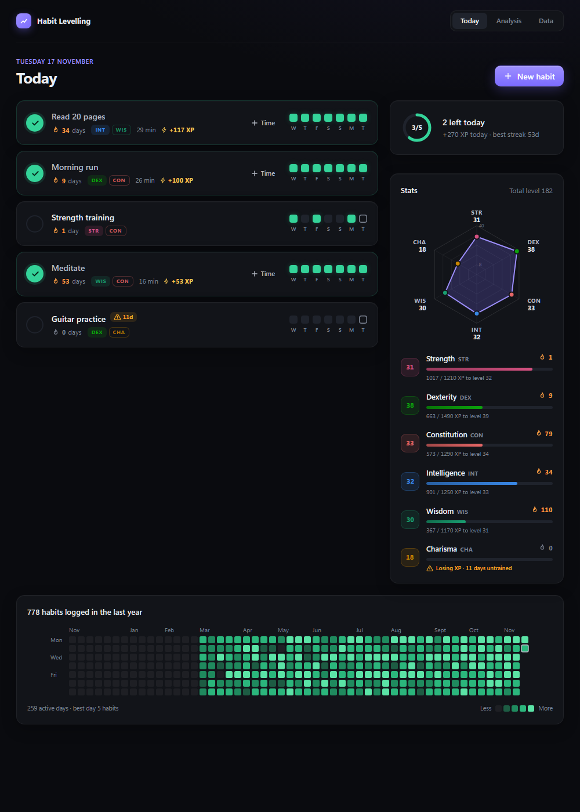
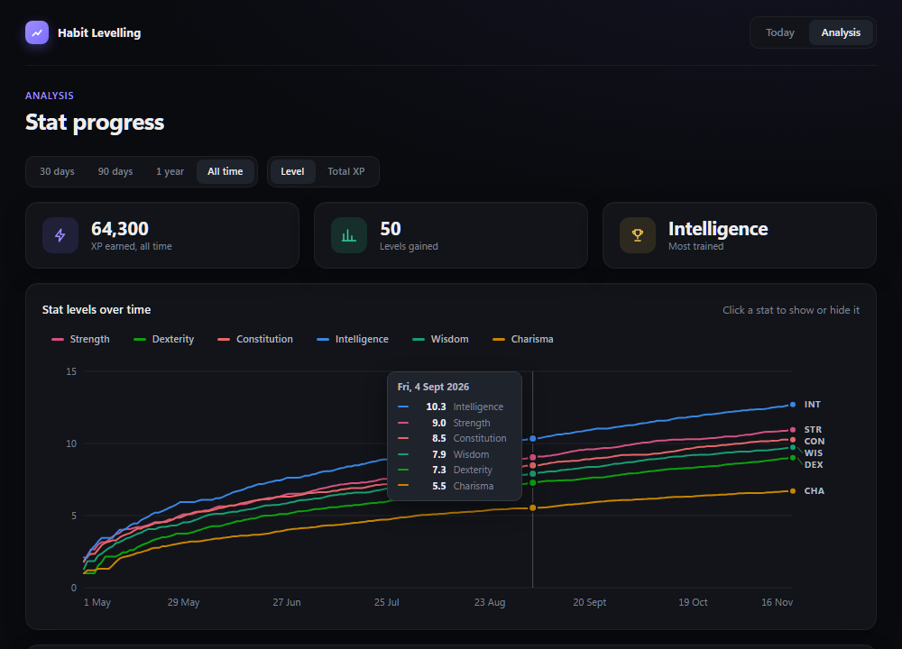

# Habit Levelling

**Turn your daily habits into an RPG character sheet.** Log what you do each day, keep your streaks alive, and level up six D&D-style stats, but let them slide and they start to fade.

Habit Levelling is a local-first app for **Windows and Android**, built with **Rust + Tauri**, **SQLite**, and a **React + TypeScript** interface. It runs entirely on your own device: no account, no server, no internet connection.



## Features

- **Daily habits.** Tick a habit off for today, log how long you spent and how hard it felt, and undo it if you mis-click.
- **Quick time logging.** Build up the time with +5, +10 and +30 minute buttons, or tap the total to type an exact time. Did a second session later? Add its time to today's log.
- **Six stats.** Each habit trains a primary stat (full XP) and optionally a secondary stat (half XP): Strength, Dexterity, Constitution, Intelligence, Wisdom and Charisma.
- **Smart stat suggestions.** Type a habit like "Study maths" or "Weightlifting" and the app suggests stats for it (Intelligence + Wisdom, Strength + Constitution).
- **Levelling that gets harder.** Your first completion levels a stat up straight away, each level after costs a little more, and level 100 takes about a year of serious daily work.
- **Streaks everywhere.** Each habit and each stat has a current and longest streak, and longer streaks earn more XP.
- **Use it or lose it.** Stats you stop training slowly lose XP, then levels. Habits you haven't done for a week get a warning.
- **A secret stat.** Luck can't be trained. It may appear when a streak hits a milestone…
- **Character overview.** A radar chart of your six stats, with an XP bar and streak for each one.
- **Activity heatmap.** A GitHub-style year of activity at a glance.
- **Analysis.** Stat levels or total XP over time for the last 30 days, 90 days, year or all time, plus a table of what changed.
- **Habit history.** A monthly calendar, recent activity and lifetime totals for every habit.
- **Backups.** Export your data to a file, restore it on another PC, and get an automatic backup every day.



## How the game works

### Earning XP

Each day you log a habit, its stats earn:

> **XP = (10 + minutes spent) × difficulty × streak bonus**

| Difficulty | Easy | Moderate | Hard | Very hard | Brutal |
| --- | --- | --- | --- | --- | --- |
| Multiplier | ×1 | ×1.5 | ×2 | ×2.5 | ×3 |

- **Streak bonus:** +5% for every day the habit's streak has run past the first, reaching ×2 on day 21. After that it keeps growing slowly, +1% for every full week, up to ×2.5 after about a year (day 371).
- **Primary and secondary stats:** the primary stat gets the full amount and the secondary stat gets half.

For example, 30 minutes of Hard studying on day 7 of a streak gives **(10 + 30) × 2 × 1.3 = 104 Intelligence** and **52 Wisdom**.

### Logging time

Each habit has one log per day. When you tick a habit off, choose how long you spent with the **+5 min**, **+10 min** and **+30 min** buttons, or tap the total to type an exact number of minutes (up to 24 hours), then pick how hard it was.

If you come back to a habit later the same day, press **+ Time** on its card and choose **Add time** to add the new session to today's total, or **Edit total** to correct it. XP is worked out from the day's total, so splitting a session into several logs never earns extra.

### Levels

Level 1 → 2 costs just 10 XP, so the first completion of any habit levels its stat up. After that, each level costs 40 XP more than the one before:

| Level up | 1 → 2 | 2 → 3 | 5 → 6 | 10 → 11 | 50 → 51 | 99 → 100 |
| --- | --- | --- | --- | --- | --- | --- |
| XP needed | 10 | 50 | 170 | 370 | 1,970 | 3,930 |

Level 100 takes 195,030 XP in total, which is about 11 months of a Hard 2-hour habit every day without breaking the streak. The XP bar resets after every level up. Levels stop at 100.

### Decay

| Days since a stat last earned XP | What happens each day |
| --- | --- |
| 0–6 | Nothing |
| 7–20 | It loses 10% of its current level's XP bar, down to 0. The level is kept. |
| 21+ | Once the bar is empty it drops a level (landing at 90% of that bar) and keeps draining. It never goes below level 1. |

Training the stat again stops the decay straight away.

### Luck

Whenever a habit's streak reaches a multiple of 7 days there's a 3% chance of +25 Luck XP. Every 30 days there's a 15% chance of +100. Luck stays hidden until you first win some.

## Download

Grab the latest version from the [Releases](../../releases) page.

**Windows** (64-bit Windows 10 and 11): download `habit_levelling.exe` and run it. There's nothing to install.

> **"Windows protected your PC"?** The app isn't code-signed yet, so Windows warns about it the first time. Choose **More info → Run anyway**.

**Android** (Android 7.0 or newer): download `habit-levelling.apk` on your phone and open it. Android asks you to allow installing apps from your browser or file manager the first time; allow it, then tap **Install**. Updates install over the top and keep your data.

## Your data

Everything is saved in a single SQLite file on your own device:

- Windows: `%APPDATA%\com.habitlevelling.app\habits.db`
- Android: inside the app's private storage (removed if you uninstall the app, so export a backup first)

Nothing is sent anywhere, and your data isn't synced between devices.

Everything about backups is on the **Data** page:

- **Export a backup** saves all your habits and daily logs as one readable `.json` file, wherever you choose.
- **Restore from a backup** replaces the app's data with a backup's contents, for example to move to a new PC or phone. Backups work across Windows and Android. It shows what the file contains and asks first. Your current data is saved as a safety backup before anything is replaced, so a restore can always be undone.
- **Automatic backups** are saved the first time you open the app each day, into a `backups` folder next to your data. The last 14 are kept.

XP, levels, streaks and decay aren't stored in backups; they're rebuilt from your logs, so a restore brings them all back exactly.

## Building from source

**You'll need:**

- [Node.js](https://nodejs.org/) (LTS)
- [Rust](https://rustup.rs/) (stable, MSVC toolchain on Windows)
- On Windows: [Visual Studio Build Tools](https://visualstudio.microsoft.com/visual-cpp-build-tools/) with the **Desktop development with C++** workload (Rust needs its linker)

**Run in development mode:**

```bash
npm install
npm run tauri dev
```

**Build a standalone `.exe`** (output: `src-tauri/target/release/habit_levelling.exe`):

```bash
npm run tauri build -- --no-bundle
```

Leave out `--no-bundle` to also build `.msi` and setup `.exe` installers under `src-tauri/target/release/bundle/`.

**Run the tests:**

```bash
cd src-tauri
cargo test
```

### Android

You'll also need a JDK 17, the Android SDK with an NDK (r27 works), and Rust's Android targets:

```bash
rustup target add aarch64-linux-android armv7-linux-androideabi i686-linux-android x86_64-linux-android
```

Set `JAVA_HOME`, `ANDROID_HOME` and `NDK_HOME`, then build a debug APK for the emulator or run it on a connected device:

```bash
npm run tauri android build -- --debug --target x86_64 --apk
```

```bash
npm run tauri android dev
```

> **Windows:** turn on **Developer Mode** (Settings → System → For developers). The Android build links the compiled Rust library into the Android project, and Windows only lets normal accounts create those links in Developer Mode.

**Release builds are signed** with a key described in `src-tauri/gen/android/key.properties`, which is git-ignored and never committed:

```properties
storeFile=C:/path/to/your-release.jks
keyAlias=your-key-alias
password=your-keystore-password
```

Without that file, release APKs are built unsigned. Keep the keystore safe: Android only installs updates signed with the same key.

> **Windows tip:** run Cargo from PowerShell or cmd, not Git Bash. Git Bash's `/usr/bin/link` shadows the MSVC linker and the build fails with `link: extra operand`.

## Architecture

All the rules live in Rust; React only displays data and calls Tauri commands.

```text
React UI (src/)  ──invoke──▶  Tauri commands (commands.rs)  ──▶  habits.rs  ──▶  SQLite (SQLx)
                                                                  │
                                         pure logic: streaks · stats · decay · luck · history · activity · recommend
```

Two design rules keep the data trustworthy:

- **Derived, not stored.** XP, levels, streaks and decay are recalculated from your completion history every time, so they can never drift out of sync. The only exception is Luck rolls: they're random, so each roll is recorded once.
- **Local calendar dates.** Completions are stored as `YYYY-MM-DD` in your local time, with one completion per habit per day.

| Path | What it does |
| --- | --- |
| `src-tauri/src/commands.rs` | Tauri commands: the frontend's only API. Decides what "today" is. |
| `src-tauri/src/habits.rs` | Habit CRUD, completions, summaries and stat queries |
| `src-tauri/src/stats.rs` | Stats, XP per completion, level curve |
| `src-tauri/src/streaks.rs` | Current, longest and per-day streaks |
| `src-tauri/src/decay.rs` | Idle stats fading, replayed day by day |
| `src-tauri/src/luck.rs` | Streak milestones and Luck rolls |
| `src-tauri/src/history.rs` | Day-by-day stat XP and levels for the Analysis page |
| `src-tauri/src/activity.rs` | A year of daily activity for the heatmap |
| `src-tauri/src/recommend.rs` | Keyword-based stat suggestions |
| `src-tauri/src/backup.rs` | JSON export, checked all-or-nothing restore, daily automatic backups |
| `src-tauri/src/db.rs` | SQLite connection and embedded migrations |
| `src-tauri/migrations/` | Database schema |
| `src/pages/` | Today (dashboard), habit details, Analysis and Data pages |
| `src/components/` | Habit cards, forms, stat panel, charts and heatmap |
| `src/lib/` | Typed command wrappers, shared types and date helpers |

## Licence

[MIT](LICENSE): free to use, modify and share, including commercially, as long as the copyright and licence notice are kept.
